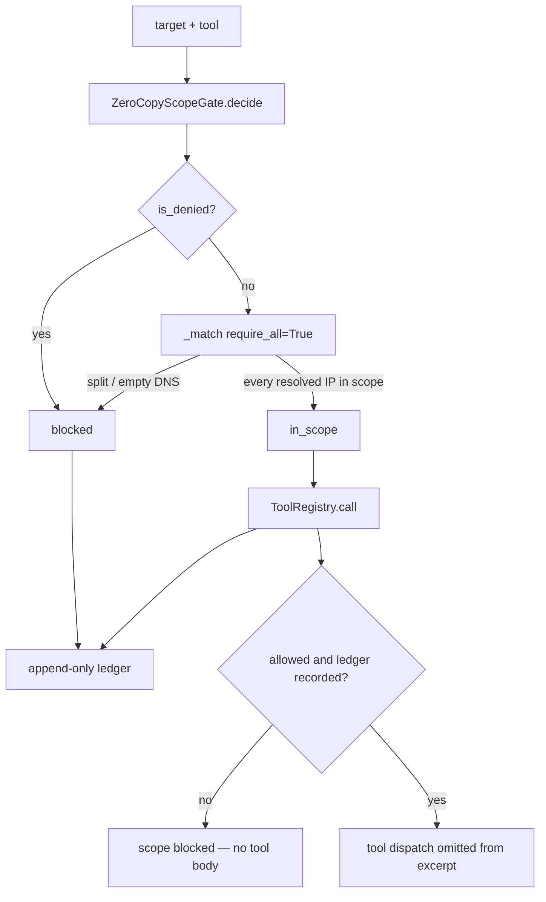

# Eve Achilles — public code excerpt

**Excerpt, not runnable.** Public redacted excerpt; not a runnable copy of the source project.

- **Source repo:** Grantgazvoda-alt/eve-achilles (default `master` at `2efb7ebc4d33dbb4dd761569b506a95ea0838c6f`, merge of PR #47)
- **Public excerpt repo:** https://github.com/Grantgazvoda-alt/eve-achilles-excerpt

## What this system demonstrates

A fail-closed scope gate for a 275-tool security-assessment agent harness. `ZeroCopyScopeGate.decide()` checks deny rules first, then allow (hostname / IP / CIDR / URL path). The normal allow path uses `_match(..., require_all=True)`: a hostname that is in scope only by DNS must have **every** resolved address in scope, or the gate fails closed (DNS rebinding / split-horizon). `ToolRegistry.call` consults the gate and writes an append-only ledger entry **before** any tool body runs. The live `scope.json` in source is loopback-only (`127.0.0.1`, `localhost`, `::1`). A 16-tool scanner toolchain is version-pinned in `toolchain.lock.json`; install-time SHA-256 verification lives in `toolchain_install.json` / `scripts/install_toolchain.py` (not copied in full here). Related tests include `tests/test_scope_rebinding.py`.

## Architecture

## Key interfaces (in this excerpt)

- `ZeroCopyScopeGate.decide` / `check` / `_match(require_all=True)`
- `ToolRegistry.register`, `_gate_and_log`, and the pre-dispatch half of `call`
- `scope.example.json` (loopback-only example, not a live engagement)
- `toolchain.lock.json` — version pins only (16 tools)

## Deliberately omitted

- The rest of `eve_achilles_harness.py` (~3,255 lines), including all scanner/tool bodies (`_nmap`, `_sqlmap`, `_ffuf`, …)
- Classes such as `C2ChannelEngine`, `WAFBypass`, `CredentialParser`, and `LOLBinMapper`
- Browser/proxy drivers, canary payload libraries, phishing-sim harness, and engagement evidence
- Owner-override and HMAC key-loading implementations (interfaces described, secrets not copied)
- Live `models.json` provider endpoints and any env-based credentials
- Working exploit, payload, or bypass code of any kind
